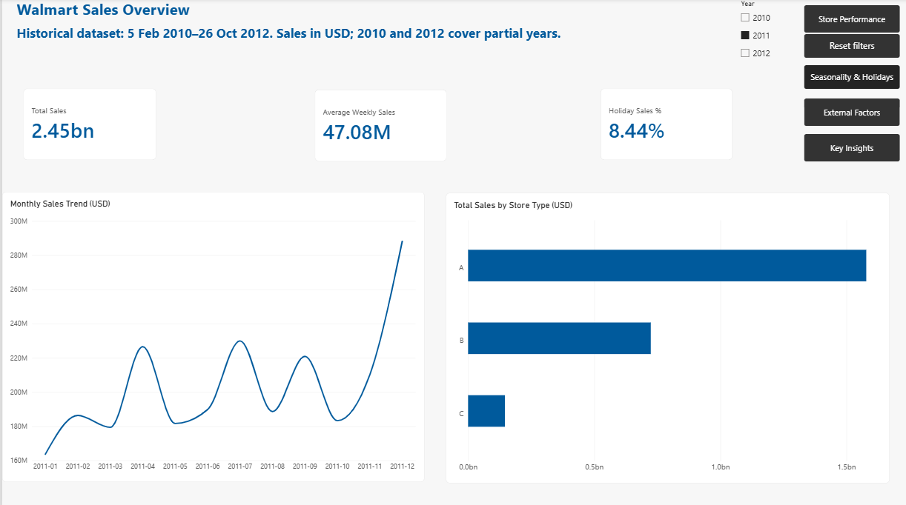
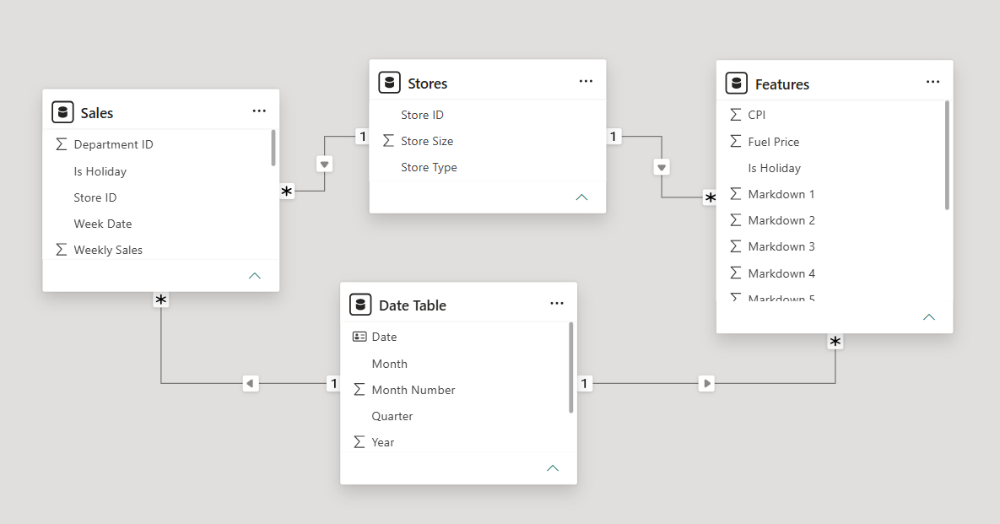

# Walmart Store Performance & Seasonal Sales Analysis

A Power BI portfolio project exploring historical sales across 45 Walmart stores. The report combines store and department comparisons, holiday analysis, and exploratory views of temperature and fuel prices to support inventory and staffing discussions.

This is an independent portfolio project using historical competition data, not an official Walmart report or a view of Walmart's entire business.

## Business questions

- How do sales vary over time and across store types?
- Which stores and departments contribute the most sales?
- How do average weekly sales differ between flagged holiday and non-holiday weeks?
- Do temperature and fuel prices show clear visual associations with weekly sales?

## Report preview



## Data source and scope

Source: [Walmart Recruiting – Store Sales Forecasting on Kaggle](https://www.kaggle.com/c/walmart-recruiting-store-sales-forecasting/data).

| Source | Purpose | Grain |
|---|---|---|
| train.csv | Historical weekly sales and holiday flags | Store, department, week |
| stores.csv | Store type and size | Store |
| features.csv | Temperature, fuel price, markdowns, CPI, unemployment and holiday flags | Store, week |

The sales data contains **421,570 rows**, covering **45 stores**, **81 department identifiers**, and **143 weeks** from **5 February 2010 to 26 October 2012**. Sales are in USD. The Features table is restricted to the sales period, giving **6,435 store-week records**. Competition test data and sample submissions are excluded from this descriptive analysis.

**2011 is the default comparison year** because it is the only complete calendar year available. The 2010 and 2012 annual totals cover partial years.

## Data preparation

Power Query was used to assign data types, rename fields, and align the source tables. The preparation workflow included:

- Checking missing values and duplicate business keys, including Store + Department + Date for sales.
- Retaining 1,285 negative sales records and 73 zero sales records rather than automatically deleting them. Their underlying business causes are not established by the dataset.
- Converting NA strings in Features to null values and preserving missing markdown information instead of treating it as zero.
- Restricting Features to the historical sales period.
- Keeping audit queries out of the loaded model.

## Data model



Two shared dimension tables filter two fact tables through active, single-direction, one-to-many relationships:

| Lookup field | Related field |
|---|---|
| Stores[Store ID] | Sales[Store ID] |
| Stores[Store ID] | Features[Store ID] |
| Date Table[Date] | Sales[Week Date] |
| Date Table[Date] | Features[Week Date] |

Sales and Features remain separate because they have different grains. Joining store-week features directly to department-level sales would repeat feature records across departments and could distort averages.

The marked Date Table covers full calendar years from 2010 through 2012. Month names and Year Month labels have numerical sort columns. Weekly sales are assigned to months according to their Week Date; they are not apportioned across calendar days.

## Measures and calculation choices

| Measure | Meaning |
|---|---|
| Total Sales | Sum of Weekly Sales in the current filter context |
| Weeks with Sales | Distinct Week Date values in Sales |
| Average Weekly Sales | Total Sales divided by Weeks with Sales |
| Holiday Sales % | Sales in flagged holiday weeks divided by Total Sales |
| Average Holiday Weekly Sales | Average Weekly Sales evaluated for flagged holiday weeks |
| Average Non-Holiday Weekly Sales | Average Weekly Sales evaluated for non-holiday weeks |
| Holiday Weekly Sales Difference % | Difference between holiday and non-holiday weekly averages, divided by the non-holiday average |
| Store Sales Share % | Store sales divided by sales across the selected stores |
| Store Sales Rank | Dense descending sales rank within the selected stores |
| Average Temperature / Average Fuel Price | Average feature values in the current filter context |

Representative DAX used in the project:

```dax
Total Sales = SUM(Sales[Weekly Sales])

Weeks with Sales = DISTINCTCOUNT(Sales[Week Date])

Average Weekly Sales =
DIVIDE([Total Sales], [Weeks with Sales])

Holiday Weekly Sales Difference % =
DIVIDE(
    [Average Holiday Weekly Sales] - [Average Non-Holiday Weekly Sales],
    [Average Non-Holiday Weekly Sales]
)

Store Sales Share % =
DIVIDE(
    [Total Sales],
    CALCULATE([Total Sales], ALLSELECTED(Stores))
)
```

Average Weekly Sales is a weekly total across the selected stores and departments, not an average department-row value. Percentage totals are recalculated in the total's filter context rather than averaged from the displayed percentages. Dynamic headings use VAR, SELECTEDVALUE, IF and RETURN to show the current store, year or department.

## Report pages

| Page | Main purpose |
|---|---|
| Sales Overview | Sales KPIs, monthly trend and store-type comparison |
| Store Performance | Store ranking, share, holiday difference and monthly sparklines |
| Store Details | Store drill-through, weekly trend and top 10 departments |
| Department Tooltip | Contextual department metrics when hovering over the department chart |
| Seasonality & Holidays | Monthly weekly-sales averages by year and holiday comparisons |
| External Factors | Weekly sales versus average temperature and fuel price |
| Key insights | Written findings, recommendations, source and limitations |
| Validation | Supporting checks; hidden from the reader view |

Store Details and Department Tooltip are also hidden from normal reader navigation and accessed through their intended interactions. The report includes year and store-type slicers, conditional formatting, four reset bookmarks, and page navigation buttons.

### Additional screenshots

- [Store Performance](screenshots/store-performance.png)
- [Store Details](screenshots/store-details.png)
- [Seasonality & Holidays](screenshots/seasonality-holidays.png)
- [External Factors](screenshots/external-factors.png)
- [Key Insights](screenshots/key-insights.png)

## Key findings: 2011

| Finding | Evidence | Business implication |
|---|---|---|
| Holiday differences vary by store type | Holiday weekly averages were 10.68% above non-holiday averages overall: Type B +15.36%, Type A +9.65%, Type C −1.26% | Review inventory and staffing by store type, then validate at store and department level |
| Sales peaked just before Christmas | The week dated 23 December recorded $77.00 million, compared with a yearly weekly average of $47.08 million | Use historical pre-Christmas demand to inform replenishment and staffing |
| Store 4 led total sales | $111.09 million and 4.54% of selected-store sales; Store 20 followed at $109.84 million | Compare similar stores and investigate department mix; total sales alone do not measure efficiency |
| External factors show no clear consistent visual pattern | Most weekly totals were approximately $40–50 million across the observed temperature and fuel-price ranges, with a few peaks | Do not use these visual patterns alone to justify causal claims or forecasts |

Total sales for 2011 were **$2,448,200,007.35** across **52 weeks**. Holiday sales represented **8.44%** of total sales. This share is different from the **10.68%** difference between holiday and non-holiday weekly averages.

The pre-Christmas peak refers to calendar timing; it should not automatically be classified as a flagged holiday week.

## How to use the report

1. Open `Walmart Sales Analysis.pbix` in Power BI Desktop.
2. Start on Sales Overview, saved with 2011 selected.
3. Use the slicers to explore years and store types, and the navigation buttons to move between pages.
4. On Store Performance, right-click a store and drill through to Store Details.
5. Hover over a department bar to see the report-page tooltip.
6. Use each page's reset button to restore its saved selection. In Desktop editing mode, use Ctrl + click for navigation and reset buttons.

The static Key insights text describes 2011 and does not recalculate when report filters change.

The PBIX contains imported data for viewing. To refresh on another computer, obtain the source CSVs from Kaggle and update the local file-source paths in Power Query before refreshing. Keep the expected columns and filenames consistent with the queries.

## Limitations

- Results describe this historical sample, not current Walmart performance or the full company.
- Partial-year coverage limits direct annual comparisons.
- Holiday and non-holiday weeks differ in seasonal context; the comparison does not isolate a causal holiday effect.
- Scatter plots aggregate feature values across selected stores, which can hide store-level relationships. Their interpretation is exploratory, not a statistical significance test.
- Costs, customer-level data and department names are unavailable; profitability and customer behaviour cannot be inferred.
- Missing markdown values limit promotion analysis; markdown effects are not evaluated in this report.
- Monthly totals can differ partly because months contain different numbers of weekly observations. The seasonality page uses average weekly sales to help address this.

## Validation and review scope

During development, checks covered duplicate keys, missing values, store totals, holiday calculations, slicer responses, drill-through context, tooltips and navigation. For example, Store 4 in 2011 produced $111,092,293.33 in total sales, $2,136,390.26 in average weekly sales and a 9.54% holiday weekly-sales difference.

The uploaded PBIX's report definitions were inspected to confirm eight pages, hidden supporting pages, four reset bookmarks, navigation targets, tooltip configuration, weekly scatter-chart grouping and the saved 2011 overview selection. The binary semantic model was not executed or independently recalculated during that file inspection. DAX examples and preparation details above reflect the documented build workflow and checks performed during development.

## Portfolio files

Keep this README beside `Walmart Sales Analysis.pbix` and a `screenshots` folder containing the seven images linked above. The screenshot links resolve when that folder is added to the same repository.

Skills demonstrated: Power Query, data quality checks, dimensional modelling, DAX filter context, ranking, percentage measures, date tables, conditional formatting, sparklines, drill-through, report-page tooltips, bookmarks, navigation and business communication.

This deliverable is a Power BI Desktop report. Power BI Service deployment, scheduled refresh and row-level security are not claimed as implemented features.
